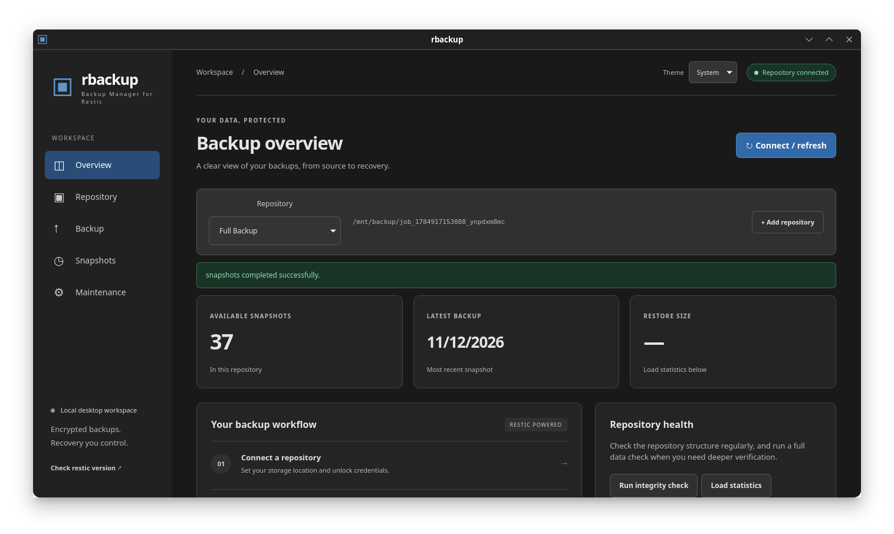

# rbackup

Backup Manager for Restic

A Tauri 2 desktop interface for restic, built with React and TypeScript. Uses real repositories and the `restic` binary on your PATH.

<!--  -->

*Backup workflow overview. Scheduled backups use Linux systemd user timers, macOS launchd, or Windows Task Scheduler.*



## Run

Install Node.js, Rust, [Tauri platform prerequisites](https://v2.tauri.app/start/prerequisites/), and [restic](https://restic.readthedocs.io/en/stable/020_installation.html). Then:

```sh
npm install
npm run tauri dev
```

`npm run dev` previews the UI in a browser; commands only execute inside Tauri.

## Build

Run these commands from the project root after installing the prerequisites and running `npm install`:

| Command | Result |
| --- | --- |
| `npm run build` | Type-check TypeScript and build the frontend into `dist/`. |
| `npm run preview` | Preview the built frontend in a browser (run `npm run build` first). |
| `npm run tauri -- build` | Build the release desktop app and all configured package formats for the current platform. |
| `npm run tauri -- build --debug` | Build the desktop app and packages with debug information. |
| `npm run tauri -- build --no-bundle` | Build the release desktop executable without installers or packages. |
| `npm run tauri -- build --bundles deb` | Build a Linux Debian package (`.deb`). |
| `npm run tauri -- build --bundles rpm` | Build a Linux RPM package (`.rpm`). |
| `npm run tauri -- build --bundles appimage` | Build a Linux AppImage. |
| `npm run tauri -- build --bundles deb,rpm,appimage` | Build all three Linux package formats explicitly. |
| `npm run tauri -- build --bundles nsis` | Build a Windows setup executable (`-setup.exe`); run on Windows. |
| `npm run tauri -- build --bundles msi` | Build a Windows MSI installer; run on Windows. |
| `npm run tauri -- build --bundles nsis,msi` | Build both Windows installer formats; run on Windows. |

Tauri build commands automatically build the frontend first. Desktop executables are written under `src-tauri/target/release/` (or `src-tauri/target/debug/` with `--debug`); packages are in the corresponding `bundle/` subdirectory. Package formats depend on the build platform and its installed prerequisites; run the Linux package commands on Linux.

For a specific architecture, use `npm run tauri -- build --target <target-triple>` with the required Rust target and platform toolchain installed. These outputs go under `src-tauri/target/<target-triple>/release/`. Run `npm run tauri -- build --help` for all build options.

### Windows build

On a Windows computer, install Node.js, Rust with the MSVC toolchain, and the [Tauri Windows prerequisites](https://v2.tauri.app/start/prerequisites/#windows) (Microsoft C++ Build Tools with **Desktop development with C++**, and WebView2). From the project root in PowerShell:

```powershell
npm ci
npm run tauri -- build --bundles nsis,msi
```

The setup executable is under `src-tauri/target/release/bundle/nsis/`, the MSI is under `src-tauri/target/release/bundle/msi/`, and the application executable is `src-tauri/target/release/rbackup.exe`. Building MSI packages also requires the Windows VBScript optional feature. For an executable without an installer, use `npm run tauri -- build --no-bundle`.

Install restic separately and make `restic.exe` available on PATH on the destination computer. Windows supports manual and scheduled backups. Create or select a password file for scheduling. Manual operations can also use a session password.

Linux builds do not produce Windows installers by default. MSI requires Windows; cross-compiling an NSIS installer requires additional tooling described in the [Tauri Windows installer guide](https://v2.tauri.app/distribute/windows-installer/).

### macOS build

On a Mac, install Node.js, Rust, and the [Tauri macOS prerequisites](https://v2.tauri.app/start/prerequisites/#macos). With Homebrew installed, run these commands from the project root:

```sh
brew install restic
npm ci
npm run tauri -- build --bundles app,dmg
```

The app bundle and disk image are under `src-tauri/target/release/bundle/`. Install `rclone` with Homebrew if you use an rclone repository. The app searches the inherited PATH followed by the standard Homebrew and macOS binary directories, including when launched from Finder.

To check an installed build, open rbackup from Finder, select **Check restic version**, then preview a backup, create a snapshot, and restore a file using a disposable local repository.

The [macOS GitHub Actions workflow](.github/workflows/macos.yml) runs tests and builds unsigned debug app bundles and disk images on Intel for pushes and pull requests. For an Apple Silicon check, select **Run on Apple Silicon** when starting the workflow manually. Public DMGs require Developer ID signing and notarization. See [Tauri's macOS signing guide](https://v2.tauri.app/distribute/sign/macos/).

## Draft GitHub releases

Push a version tag such as `rbackup-0.1.2` or `v0.1.2` that matches the version in the tagged commit. In GitHub, open **Actions → Draft desktop release → Run workflow** and enter that tag. The [release workflow](.github/workflows/release.yml) builds a Linux Debian package, a Windows NSIS installer, and an unsigned universal macOS DMG. After all three builds succeed, it attaches the installers to a draft GitHub Release with generated notes. Review the draft before publishing and sign and notarize the macOS bundle for public distribution.

## Workflow

The header stays visible while the workspace below it scrolls. Tab to **Workspace content** to scroll with the keyboard.

1. Open **Repository**, enter the repository location, and supply a session password or an absolute password-file path. Select **Connect**. If restic reports that the location has no repository, **Initialize new repository** becomes available. This detection requires restic 0.17.0 or newer.
2. Open **Backup**, enter absolute source paths (one per line), optional excludes and tags. Preview with dry run, then uncheck dry run to create a snapshot.
3. Refresh, open **Snapshots**, and choose **Browse / restore**. Use the dedicated snapshot browser to restore an individual file, a folder, or the entire snapshot into a new or empty absolute destination directory. Restored content is verified; existing files are never overwritten.
4. Open **Maintenance** to check metadata or read all stored data. Preview retention before typing `FORGET` to apply. Prune separately to reclaim unreferenced storage.

Profile names, repository locations, source paths, exclusions, tags and password-file paths save automatically in the desktop webview's local storage. Password text stays in React/process memory unless you explicitly use **Create password file**; it is never written to profile storage or command-line arguments. Clearing it removes it from UI state; memory is not explicitly zeroized. Keep an independent copy of your password: losing it prevents recovery.

The app remembers the last selected repository and reconnects on startup and when you switch profiles using the selected profile’s saved password file, loading its snapshots. Without a password file, it opens Repository settings so you can enter your session password and connect. Connection failures appear in the status message and can be retried with **Connect / refresh**.

Remote backend support uses restic repository URLs and credentials inherited from the environment launching the desktop app. No provider-specific credential manager is included. Avoid credentials in URLs because profile metadata is stored unencrypted.

For AWS S3 or compatible storage, open **Repository → Set up an S3 repository** and enter the service endpoint, bucket, and optional repository prefix. Select **Use S3 location**, then **Connect**. Configure provider credentials for the desktop process and the scheduled account, for example through `AWS_ACCESS_KEY_ID` and `AWS_SECRET_ACCESS_KEY`, with `AWS_SESSION_TOKEN` for temporary credentials. Set `AWS_DEFAULT_REGION` in those environments when the provider requires a region override.

SFTP connections use non-interactive SSH batch mode with strict host-key verification. Set up an SSH key or agent and verify the server's host key outside the app first; missing authentication or unknown/changed host keys fail in the app instead of asking for passwords or host approval. An encrypted SSH key must already be unlocked through an agent. The restic repository password and password file are separate from SSH authentication. These rules apply to stale-lock cleanup, manual backups, automatic maintenance and scheduled backups. On Windows, restic is launched without a console window; native Windows verification is still required for SSH subprocess behavior.


## Validation

Rust build caches live in `src-tauri/target/` and can grow much larger than the source, especially after toolchain or dependency updates. Development builds disable debug symbols and incremental compilation to reduce disk usage (at the cost of slower rebuilds and reduced Rust debugger information). Test builds inherit these settings. To remove all Rust build output, including app executables and installers, run `cargo clean --manifest-path src-tauri/Cargo.toml`; the next build regenerates it. Build output is ignored by Git. For one-off Rust debugging, use `CARGO_PROFILE_DEV_DEBUG=2` when building.

```sh
npm run build
cargo test --manifest-path src-tauri/Cargo.toml --lib
cargo test --manifest-path src-tauri/Cargo.toml --lib -- --ignored --test-threads=1
```

The ignored restic lifecycle test requires restic on PATH. It creates a disposable repository under the system temp directory, tests initialization, backup preview, exclusions, tags, snapshot/file listing, verified restore, refusal of nonempty restore targets, statistics, full data check, retention, pruning, password-file authentication and incorrect-password handling. It does not access your repositories.

Run `npm test` for the frontend tests, including profile settings, log formatting, and restore selection. Run `npm run test:restore` for the checkbox-selection checks and a focused real-restic restore regression. It backs up disposable files, deletes the originals, restores selected files and folders through the UI request format, compares binary contents, checks that unchecked files stay excluded, verifies nonempty destinations preserve user edits, and tests restoring the entire snapshot. It never uses your configured repositories or jobs.

On Linux, the desktop smoke test drives the Tauri app through WebDriver with real Restic. It checks that preview creates no snapshot, backup reloads the snapshot list and keeps its log, and restoring a selected file preserves its contents. Put Restic, `WebKitWebDriver` (from your distribution's WebKitGTK driver package), and `tauri-driver` (`cargo install tauri-driver --locked`) on `PATH`. Build with `npm run tauri -- build --debug --no-bundle`, then run `npm run test:desktop`. On a headless machine, use `xvfb-run -a npm run test:desktop`. The test uses a temporary app home and repository.

## Current limits

Operations execute off the UI thread. On Linux, macOS, and Windows, manual and scheduled operations share a cross-process lock; scheduled jobs wait while manual operations report when another app operation is busy. **Logs** shows formatted operation output after completion, recent operations, and scheduled-run output for the selected profile. Expand **Raw output** to see the original text. Use **Cancel operation** to stop an app-owned restic operation. Keep the app open until the operation finishes or cancellation completes. Activity history is session-only and output is held in memory. Snapshot browsing opens in a dedicated dialog with an expandable folder tree and checkboxes. Folder contents load lazily and remain cached while the browser is open; large folders reveal another 100 items at a time. Select individual files or entire folders, then use the single **Restore selected** action. A checked folder includes its descendants; unchecking a child preserves the other selected contents. The root checkbox selects the entire snapshot. Original paths are preserved within the destination. Browsing skips the stale-lock cleanup subprocess. Use arrow keys to navigate the tree, Right/Left to expand/collapse, and Space to toggle a selection. Paths are typed rather than selected with native dialogs. Scheduling is available through systemd user timers on Linux, launchd on macOS, and Task Scheduler on Windows. No keychain, repair, manual unlock, copy or key-management workflow yet.

**Mount snapshot** uses Restic’s read-only FUSE mount on Linux and macOS. On Linux, install FUSE and `fusermount3` or `fusermount`. On macOS, install FUSE-T or macFUSE and complete its setup. The [Restic mount documentation](https://restic.readthedocs.io/en/stable/050_restore.html#restoring-using-mount) links to both macOS options.

The repository is mounted in a private temporary directory. The workspace banner’s **Browse mounted snapshot** opens it in the app, and **Copy path** lets you open the selected snapshot in your file manager. In Finder, use **Go → Go to Folder** and paste the path. Snapshot symbolic links are displayed without following their targets. One repository can be mounted at a time.

Use **Unmount** before repository maintenance. Restic’s live repository lock protects mounted data from pruning. The app also unmounts on normal exit. After a crash or forced quit, the mountpoint is the `files` directory above `ids/`. To unmount it manually, use `/sbin/umount <mountpoint>` on macOS or `fusermount3 -u <mountpoint>` on Linux. Windows supports the built-in snapshot browser and restores.

To test a macOS mount, use a disposable repository with a known file. Confirm that the file opens from the mounted snapshot in Finder, unmount in rbackup, and check that the mount path disappears. Mount again and quit the app to check exit cleanup. The opt-in smoke test exercises the Restic mount command, read-only access, and cleanup on a machine with FUSE installed.

```sh
cargo test --locked --manifest-path src-tauri/Cargo.toml --lib mount::tests::real_fuse_mount_exposes_selected_snapshot_and_unmounts -- --ignored --exact
```

See [implementation plan](docs/PLAN.md) and [review notes](docs/REVIEW.md) for decisions, validation results and next steps.

Restic behavior follows the [official manual](https://restic.readthedocs.io/en/stable/manual_rest.html) and the installed CLI help (tested with restic 0.18.1).

## First launch

A fresh install starts with one blank repository profile. No personal jobs, paths, exclusions, credentials, or schedules are bundled. Configure your repository and credentials before connecting. Existing saved profiles remain available on upgrades; installing a new package does not clear existing webview storage.

Click **+ New profile** beside **Backup profile** to add another job. The app selects the new profile and opens **Repository** for setup. Each profile has its own sources, exclusions, and optional schedule. Select the profile before editing **Backup → Backup schedule**.

Run profile persistence and clean-start checks with `node tests/profiles.test.ts` (Node.js 22.18+ or 24+).

Choose **System**, **Light**, or **Dark** from the header's **Theme** selector. System is the default and follows OS appearance changes; explicit preferences persist on this device.

The desktop app starts at 1100 × 760 and saves normal window size and position as you resize or move it. Sizes are stored in logical units so changing display scaling does not enlarge the restored window. It creates the window with the saved size, restores position, and shows the window afterward; maximized, minimized, and fullscreen sizes are not restored. Geometry that fills the monitor work area (within decoration margins) is also excluded because native maximize-state notifications can lag resize events. Old unversioned caches are reset once because they may contain maximized dimensions. Existing screen-filling caches fall back to the default size; manually resized windows that fill the work area follow the same rule. Geometry is stored in `window-geometry.json` under Tauri's app configuration directory (`~/.config/com.michael.backup-manager/` by default on Linux). The previous plugin's window cache is ignored once; repository settings are preserved. Monitor placement depends on the desktop compositor; Wayland may control placement itself.

## Developer documentation

Open [the static developer reference](docs/index.html) directly in a browser for application flow, function and type contracts, supported operations, and documentation maintenance. No documentation server or dependencies are needed. Source functions include JSDoc and rustdoc comments for editor tooltips; the page also explains how to generate Rust API documentation.

## Automatic stale-lock cleanup

Before each operation on an existing repository, the app runs `restic unlock` with the same repository and credentials. Restic decides which locks are stale; the app never uses `--remove-all` or bypasses repository locking. Initialization and version checks skip cleanup. Cleanup also runs before backup and retention previews, so a preview can remove stale lock files while leaving backup data unchanged. If cleanup fails, the requested operation is cancelled and the error appears in the status message. Cleanup runs when you use a repository, rather than on a background timer.

## Create a password file

In **Repository**, enter the **Session password**, then click **Create password file**. The app saves the path to a new file in the profile. On Windows, it creates `%LOCALAPPDATA%\tauri-backup-manager\passwords\<profile-id>.password` with an access control list restricted to the current Windows user. On Linux and macOS, it creates `~/.local/share/tauri-backup-manager/passwords/<profile-id>.password` with owner-only permissions (0600) in an owner-only directory (0700). You can also enter an existing password file manually. Empty passwords and passwords containing line breaks are rejected. The password is saved exactly as entered, including spaces. The profile is updated to reference this path, so subsequent repository commands use it. The file contains the plaintext repository password and is protected by filesystem permissions.


## Cancel long operations

While restic is running, **Cancel operation** appears below the status banner. On Linux/macOS the backend sends SIGINT to its current child process, allowing restic to clean up; after ten seconds it force-terminates a child that has not exited. On Windows it terminates the child directly. Output is retained, cancellation is shown in amber, and loaded repository data is invalidated. Cancellation also applies during the automatic unlock preflight. It cannot stop external processes or processes from an earlier app instance. Changes already made are not rolled back; refresh the repository after cancelling, and use an integrity check after interrupted maintenance. Forced termination can leave a stale lock for the next operation to clean up.

## Scheduled backups (Linux)

1. Configure the repository, sources, exclusions, and tags. Set an existing readable **Password file**, or use **Create password file**. Session-only passwords cannot authenticate unattended backups.
2. Open **Backup → Backup schedule**, select daily or weekly, choose a local time and weekdays, then turn on **Enable scheduled backups**. Schedule settings save automatically. Turning the switch off keeps your frequency, time, and weekdays for the next time you enable it. Every profile defaults to daily 3:00 AM **disabled**. No legacy schedule is activated automatically.
3. The panel shows the next timer occurrence, active/waiting state, last result, and the last 100 journal lines (up to 64,000 characters). **Cancel scheduled backup** stops running or queued work. Closing the app does not cancel a scheduled service.

Scheduled jobs always create snapshots; the manual backup dry-run checkbox does not affect them. Automatic maintenance runs after a successful backup when enabled for that profile. Backups run during your systemd user login session, even with the app closed. A persistent timer catches up once after missed runs when the user manager resumes; it does not replay each missed occurrence or wake a sleeping computer. Scheduling before login requires separately configuring systemd user lingering; the app does not change it. Local times and daylight-saving behavior follow systemd and the computer's timezone. Failed runs are recorded without automatic retries.

Schedule metadata and the backup settings snapshot live in `~/.local/share/tauri-backup-manager/schedules/<profile-id>.json`, with mode 0600 inside an owner-only directory. Password text is never included. Last-run results are in `<profile-id>.status.json`. Other app processes share `~/.local/share/tauri-backup-manager/operation.lock`. Do not delete lock files while operations are running; locks are released by closing their descriptors.

Timers and services are named `tauri-backup-manager-<profile-id>.timer` and `.service` under `$XDG_CONFIG_HOME/systemd/user` (default `~/.config/systemd/user`). Saving validates the calendar with `systemd-analyze`, captures the absolute restic executable path, and installs/enables the timer. The service launches the app executable with `--scheduled-backup <profile-id>` before any GUI initialization. AppImages use the original AppImage path. Keep that executable installed at its saved location; after moving or deleting an app/build or restic installation, save schedules again. Development-build timers depend on the development executable continuing to exist.

Saved profile edits synchronize to the scheduled configuration after a short debounce; invalid backup settings disable the timer. The currently running backup uses its loaded settings; later runs use the updated profile. Disabling or removing a schedule stops its timer and service first. Removing a profile preserves repository data and password files. Installation errors restore previous configuration where possible and report recovery errors explicitly.

Scheduled remote backups inherit the **systemd user manager environment**, which may differ from the desktop app or terminal environment. SSH agents, remote provider credentials, and mount availability must work in that session. Missing mounts, unreadable password files, and external active repository locks cause a visible failure; no force-unlock is used. Scheduled cancellation uses SIGINT with a ten-second grace period before forced termination, and service shutdown has a fifteen-second limit. Completed changes are not rolled back.

For troubleshooting (replace `<profile-id>` with the profile's ID):

```sh
systemctl --user status tauri-backup-manager-<profile-id>.timer
systemctl --user status tauri-backup-manager-<profile-id>.service
journalctl --user -u tauri-backup-manager-<profile-id>.service -n 100
```

Linux scheduling requires an accessible systemd user session.

### Scheduler checks

```sh
cargo test --manifest-path src-tauri/Cargo.toml --lib
cargo test --manifest-path src-tauri/Cargo.toml --test scheduler_headless
cargo test --manifest-path src-tauri/Cargo.toml --lib scheduler::tests::generated_units_pass_systemd_validation -- --ignored --exact
cargo test --manifest-path src-tauri/Cargo.toml --test scheduler_headless systemd_user_timer_runs_closed_app_and_catches_up -- --ignored --exact
```

The normal headless tests use temporary homes and repositories, cover password-file backups, queued/running cancellation, serialization, validation, and argument forwarding, and do not install timers. The unit verifier creates temporary unit files without activating them. The final, opt-in test needs a real systemd user session and installs uniquely named **runtime** units for generated temporary backup data, verifies app-closed execution and one missed-run catch-up, and removes its units and timer state afterward. It never enables a saved user schedule.

## Scheduled backups on Windows

In **Repository**, create a password file or enter its absolute path. In **Backup → Backup schedule**, choose a daily or weekly local time and enable the schedule. Changes save automatically. Windows Task Scheduler runs the headless backup using your account while you're signed in, including when the app is closed or the workstation is locked. Windows can start missed runs when the task becomes available. The task runs without elevation, allows battery power, and uses the credentials and drives available to that Windows session. See [Windows Task Scheduler settings](https://learn.microsoft.com/en-us/powershell/module/scheduledtasks/new-scheduledtasksettingsset).

The app shows the next run, active state, last result, and recent output from the latest run. **Cancel scheduled backup** requests cancellation through the app so the headless runner can stop its restic child. Profile changes update future runs. Invalid settings disable the task, and removing a profile removes its task.

Tasks appear in the Task Scheduler Library as `tauri-backup-manager-<user-SID>-<profile-id>`. Schedule settings, results, and logs are stored under `%LOCALAPPDATA%\tauri-backup-manager\schedules`. The schedule stores the password-file path and the absolute restic executable path. Turn the schedule off and back on after moving the app or restic.

To verify a Windows installation, use a disposable repository and save a schedule. Close the app, select the matching task in Task Scheduler, and click **Run**. Reopen the app to verify the result, output, and snapshot. For a longer run, verify cancellation in the app, then disable the schedule and remove the test profile.

## Automatic maintenance

In **Maintenance → Automatic maintenance**, enable **After each successful backup** for the selected repository. Choose the retention counts (initially 3 last, 7 daily, 4 weekly, and 6 monthly) and optionally enable reading all backup data during the integrity check. Settings save automatically and synchronize to existing scheduled jobs; existing profiles start with automatic maintenance off.

After a successful manual or scheduled backup, the app runs `restic check`, then `restic forget` with the saved automatic retention policy, then `restic prune`. This policy is separate from the manual retention preview controls. Automatic retention deletes snapshots outside the policy and pruning reclaims their unreferenced data. At least one retention count must be positive; invalid policies stop the operation before backup begins. Check uses metadata validation unless reading all data is enabled.

Restic can continue past unreadable files and save a partial snapshot of the readable data. An incomplete backup (exit 3) shows a warning with details in the operation or scheduled-run output. Dry runs, failed backups, incomplete backups, and cancelled backups skip maintenance. A failed or cancelled maintenance step stops all later steps. Backup and maintenance share the operation lock and cancellation handling. Results and output include maintenance; a maintenance failure does not undo the completed backup. Scheduled maintenance runs in the same headless job as the backup, using its saved password file on Linux, macOS, and Windows.

## Scheduled backups on macOS

Install rbackup in `/Applications` or another stable location. In **Repository**, select or create a password file. In **Backup → Backup schedule**, choose a daily or weekly local time and enable the schedule. Each enabled profile installs a LaunchAgent in `~/Library/LaunchAgents`. Jobs can run with rbackup closed while you are signed in, and launchd can catch up on calendar events missed during sleep. If rbackup moves, save the schedule again from its new location.

The schedule panel shows the last result and recent output from the last scheduled run. If macOS denies access to a source or destination, review the scheduled-run output and the relevant privacy or background item settings in System Settings. Schedule metadata and the operation lock are stored under `~/.local/share/tauri-backup-manager/`.

To test with a disposable repository, enable a schedule, quit rbackup, and run `launchctl kickstart "gui/$(id -u)/com.michael.backup-manager.schedule.<profile-id>"` with the ID from the LaunchAgent filename. Reopen rbackup to verify the snapshot and logs. Test cancellation during a longer run, then disable the schedule and check that its LaunchAgent file has been removed.
